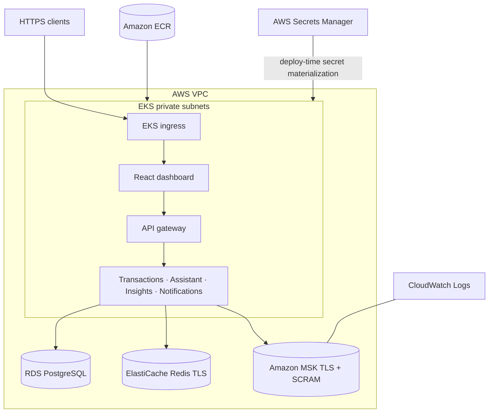

# Architecture

## 1. Context & Goals

This platform demonstrates a production-style pattern for embedding LLMs inside a financial services backend, without treating the LLM as a bolt-on. Goals, in priority order:

1. **Correctness of financial data** — the LLM never writes ledger data and never computes a figure; it only labels, rewords, or summarizes. All money-affecting writes go through deterministic, testable service code.
2. **Responsiveness under load** — AI calls are slow and rate-limited relative to a DB write, so the system is designed around caching and asynchronous enrichment rather than synchronous LLM calls on the request path.
3. **Graceful degradation** — every AI path has a deterministic fallback. `LLM_ENABLED=false` is a supported, fully working mode, not a broken state.
4. **Service independence** — each microservice can be deployed, scaled, and tested independently.
5. **Observability & repeatable delivery** — every service ships with health and readiness probes, Prometheus metrics, structured JSON logs with propagated request IDs, CI validation, and a scripted deployment path.

**Non-goals:** this is not a payments processor (no money movement or settlement), and it does not aim for PCI-DSS compliance — it's a portfolio demonstration of architecture patterns, not a licensed financial product.

---

## 2. High-Level Design

```
┌──────────────┐  nginx /api/* ┌──────────────────────────────────────────────────────┐
│ React        │──────────────▶│                   Gateway Service                    │
│ dashboard    │               │  - Register / login / refresh (JWT)                  │
│ (or any      │               │  - Mints internal identity, strips client headers    │
│  HTTP client)│               │  - Per-user, two-tier rate limiting (Redis)          │
└──────────────┘               │  - Reverse proxy to /api/v1/{service}/...            │
                               └───────┬───────────────┬───────────────┬──────────────┘
                                       │               │               │
                           ┌───────────▼──┐   ┌────────▼───────┐   ┌───▼─────────────┐
                           │ Transactions │   │   Assistant    │   │   Insights      │
                           │              │   │                │   │                 │
                           │ - Ingest tx  │   │ - Guardrail    │   │ - /trends (SQL) │
                           │ - Categorize │   │ - SQL retrieval│   │ - /summary (SQL │
                           │   (LLM/rules)│   │ - Python draft │   │   + LLM wording)│
                           │ - Anomaly    │   │ - LLM rewording│   │                 │
                           │   score      │   │                │   │                 │
                           └──┬───────┬───┘   └───────┬────────┘   └────────┬────────┘
                              │       │               │                     │
                              │       │       ┌───────▼────────┐            │
                              │       └──────▶│ libs/llm_client│◀───────────┘
                              │               │ cache · limiter│
                              │               │ breaker · evals│──▶ OpenAI (redacted input)
                              │               └───────┬────────┘
                              │                       │
                         ┌────▼─────┐           ┌─────▼─────┐
                         │  Kafka   │           │   Redis   │  cache, rate limits,
                         │ (events) │           │           │  chat history
                         └────┬─────┘           └───────────┘
                              │
                     ┌────────▼───────────┐
                     │  Notifications     │
                     │  consumer → rules  │
                     │  → stored alerts   │
                     └────────────────────┘

      All five services read and write PostgreSQL (the system of record) through libs/db.
```

---

## 3. Service Boundaries

| Service | Port (compose) | Owns | Talks to |
|---|---|---|---|
| **Gateway** | 8000 | Users and credentials, JWT issue/verify, routing, edge rate limiting, aggregated readiness (`/api/v1/status`) | PostgreSQL (`users`, starter `accounts`), Redis, all downstream services (HTTP) |
| **Transactions** | 8001 | Ingestion, idempotency, balances, categorization, anomaly scoring, audit trail, event publishing | PostgreSQL (read/write), Redis + OpenAI via `llm_client`, Kafka (producer) |
| **Assistant** | 8002 | Read-only Q&A over the user's ledger, conversation history | PostgreSQL (read), Redis (history), OpenAI via `llm_client` |
| **Insights** | 8003 | Aggregate reporting and AI summaries | PostgreSQL (read), Redis + OpenAI via `llm_client` |
| **Notifications** | 8004 | Alert rules, stored alerts, delivery | Kafka (consumer), PostgreSQL (`notifications`), delivery channel (logs today) |
| **Dashboard** | 3000 | React UI; nginx serves it and proxies `/api/*` to the Gateway | Gateway only |

**Rule of thumb:** only the **Transactions** service writes financial records (transactions, balances, categories on a transaction, audit entries). The Gateway writes identity (`users`, and a zero-balance starter account at registration); Notifications writes only its own `notifications` table; Assistant and Insights are read-only. That keeps the money-affecting write path small, auditable, and easy to test exhaustively.

All services share one database and one schema (`libs/db`) for simplicity. This is a deliberate shortcut — see 7.5.

### Shared libraries

| Library | Contents |
|---|---|
| `libs/common` | App factory (`/health`, `/ready`, `/metrics`, error handlers), settings, JSON logging, request-ID middleware, auth dependencies, description normalization/redaction, Redis client |
| `libs/db` | SQLAlchemy 2.0 async models, repositories, session management, category taxonomy, Alembic migrations |
| `libs/events` | Event schemas, Kafka publisher (plus null and in-memory variants), idempotent consumer |
| `libs/llm_client` | OpenAI wrapper, merchant-keyed cache, Redis token bucket, circuit breaker, versioned prompts, metrics, labeled eval set |

---

## 4. Data Model

Local Docker Compose runs a one-shot `database-init` job against healthy PostgreSQL before
starting any API service. It applies migrations and creates an empty local starter workspace idempotently;
a setup failure blocks service startup. All deployment paths initialize the canonical category
taxonomy through migrations. Kubernetes and AWS do not need a demo seed for categorization;
the explicit seed command is only needed for the optional local starter workspace.

```
users 1──* accounts 1──* transactions *──1 categories
  │                          │
  └──────* notifications *───┘          audit_log (append-only, references any entity)
```

| Table | Key columns | Notes |
|---|---|---|
| `users` | `id` (`usr_…`), `email` (unique), `hashed_password` (bcrypt), `is_active` | |
| `accounts` | `id` (`acct_…`), `user_id`, `name`, `currency`, `balance` | `balance` is adjusted by Transactions at ingest, in the same DB transaction. |
| `categories` | `slug` (PK), `name`, `description` | Fixed taxonomy of 17, initialized by migration; runtime definitions live in `libs/db/categories.py`. |
| `transactions` | `id` (`tx_…`), `account_id`, `external_tx_id`, `amount` (`NUMERIC(18,2)`), `description`, `normalized_description`, `merchant`, `status`, `category_slug`, `category_source`, `anomaly_score`, `occurred_at`, `categorized_at` | Unique on `(account_id, external_tx_id)` for idempotency. Indexed on `(account_id, occurred_at)` and `status`. |
| `notifications` | `id` (`notif_…`), `user_id`, `transaction_id`, `type`, `message`, `dedupe_key` (unique), `read`, `delivered_at` | The unique dedupe key makes alert creation idempotent; null `delivered_at` retains pending channel work for event replay. Budget keys include user and currency. |
| `audit_log` | `actor`, `action`, `entity_type`, `entity_id`, `payload` (JSON) | Written on ingest, categorization, and user recategorization. |

Migrations live in `libs/db/migrations/versions/`, using UTC timestamp filenames:
`20260909015537_initial_schema.py`, `20260909015537_notification_dedupe_key.py`, and
`20261002063931_notification_delivery.py`, `20261007160000_durable_jobs_and_outbox.py`, and
`20261028160000_seed_canonical_categories.py`. Existing internal revision IDs (`0001`–`0004`)
remain stable for database compatibility; Alembic orders migrations by their parent revision,
and new revisions use unique IDs. Money is always `Decimal`/`NUMERIC`, never
float, in storage and in API payloads.

Amounts in different currencies are never added together. Insights summaries and trends, assistant answers, and budget alerts each total one currency — by default the one most of the user's accounts are held in — and Insights lists the currencies it left out (`other_currencies`). There is no FX conversion.
Assistant drafts and LLM replies also disclose excluded currencies. Largest-outflow retrieval
filters the full ledger in SQL before ordering by amount and limiting; it does not sample a
recent page. The dashboard loads the summary first and uses its server-provided UTC window for
transaction totals; labels stay with the loaded period while a new period is requested.
Displayed ledger dates also use UTC so date-only entries retain the date the user entered.

---

## 5. Data Flow: "New Transaction" (the core flow)

1. A client posts a raw transaction to the Gateway, which authenticates it, rate-limits it, and forwards it to `Transactions` with a minted internal identity.
2. `Transactions` checks account ownership and idempotency, then in one DB transaction writes the row as `pending_categorization` (with a redacted `normalized_description` and a best-guess `merchant`), adjusts the account balance, and records an audit entry. It commits and returns `202 Accepted` — the write is never blocked on the LLM. A replay of the same `(account_id, external_tx_id)` returns the existing row with `200`.
3. A durable job, committed with ingestion, categorizes the row under an expiring lease:
   - With the LLM enabled: merchant-keyed Redis cache → Redis token bucket → circuit breaker → OpenAI (JSON-only, validated against the taxonomy) → cache. Any refusal or failure falls through to the rules engine.
   - With the LLM disabled: the rules engine directly.
4. The **anomaly score** is computed deterministically from the amount relative to the account's own history (mean and max of *other* transactions). Inflows always score 0.
5. The row becomes `categorized`; the audit entry, outbox events and job completion commit together.
6. A separate outbox loop publishes to Kafka topic `transactions.events`: `transaction.categorized` always, plus `transaction.anomaly_flagged` when the score is at or above `ANOMALY_ALERT_THRESHOLD`. It marks completion only after acknowledgement; retries retain the event ID.
7. `Notifications` consumes them, evaluates alert rules (anomaly, large outflow, monthly category budget), inserts alerts idempotently, and delivers them after commit.
8. `Insights` does **not** consume events: it aggregates from PostgreSQL on read, so a new transaction is reflected in `/insights/summary` and `/insights/trends` as soon as it is committed.

This keeps the synchronous request path fast while AI enrichment happens asynchronously and fans out via events.

---

## 6. How each AI feature stays safe

| Feature | What the LLM does | What it never does | Fallback |
|---|---|---|---|
| Categorization | Picks one slug from the fixed taxonomy for a redacted merchant string + amount | See raw descriptions, card fragments, store or reference numbers | Rules engine (95% on the labeled set, CI gate 90%) |
| Assistant | Rewords a Python-composed draft using supplied facts | Retrieve data, compute figures, trigger writes | The draft itself (`reply_source: "draft"`) |
| Summary | Writes a sentence over per-category aggregates | See individual transactions | Templated sentence (`summary_source: "fallback"`) |

The assistant's read-only guarantee is a regex gate in `services/assistant/guardrails.py` that runs before retrieval or any model call — not a prompt instruction.

---

## 7. Key Decisions & Trade-offs

### 7.1 Why event-driven (Kafka) instead of direct service-to-service calls?
- **Decision:** Transaction lifecycle changes are published as events; Notifications subscribes rather than being called synchronously.
- **Why:** Decouples `Transactions` from `Notifications` — either can go down or be redeployed without blocking ingestion. Events are keyed by `account_id` so per-account ordering holds.
- **Trade-off:** Operational complexity (running Kafka/MSK) and eventual consistency — a client polling immediately after posting may briefly see `pending_categorization`.
- **Outbox recovery:** failed publishing leaves committed rows available for retry. Claims use `FOR UPDATE SKIP LOCKED` and account FIFO ordering. Expired leases fence stale database completion. Delivery is at least once: a crash after acknowledgement can replay an event. Delayed duplicate deliveries do not provide an exactly-once ordering guarantee.
- **Consumer recovery:** failed handlers and offset commits retry the same record before reading
  another; only the processed partition's next offset is committed. Fetch failures retry too.
  Rebalance callbacks invalidate the in-flight assignment epoch and resume polling, even while
  aiokafka still exposes its previous assignment. Stale epochs cannot commit.
  Malformed events are logged and skipped. A persistent handler error delays all partitions
  assigned to that consumer; per-partition workers and a dead-letter queue remain future work.
- **Delivery recovery:** stored notifications retain pending delivery until the channel succeeds.
  Event replay delivers pending rows even if a ledger correction no longer triggers the rule.
  Success is committed separately; a crash between send and success tracking can duplicate a
  channel delivery. External channels should use the stable alert dedupe key for idempotency.

### 7.2 Why cache LLM responses in Redis, keyed on the merchant?
- **Decision:** Categorizations are cached under a hash of the first two tokens of the normalized description (`llm:cat:<prompt version>:<sha256>`, so bumping a prompt version starts a fresh cache), for `LLM_CACHE_TTL_SECONDS` (default 7 days). Summaries are cached on a hash of the aggregates.
- **Why:** LLM calls are the slowest and most expensive part of the system, and the same merchant appears constantly across branches (`STARBUCKS #1234 SEATTLE WA`, `STARBUCKS #9876 PORTLAND OR`).
- **Trade-off:** A wrong cached answer would repeat, so a user correction (`PATCH /transactions/{id}`) invalidates that merchant's entry. Two different merchants sharing their first two tokens would share a cache entry.

### 7.3 Why keep the LLM off the synchronous write path?
- **Decision:** Transaction writes never wait on an LLM call.
- **Why:** LLM APIs have variable latency and can fail or rate-limit; financial writes must not depend on a third-party AI service.
- **Trade-off:** Requires a `pending → categorized` state machine and durable job table. API replicas run independent polling loops. Provider calls run outside database locks; jobs use a 120-second lease and retry with capped exponential delay. After 10 attempts, a job is parked for operator investigation. User category corrections lock the transaction and win over late enrichment results.

### 7.4 Why aggregate on read for Insights?
- **Decision:** Insights computes figures from PostgreSQL per request rather than maintaining event-derived counters.
- **Why:** One source of truth, no double-counting on redelivery, and no backfill problem. At this data volume the queries are cheap and indexed on `(account_id, occurred_at)`.
- **Trade-off:** Cost grows with history; materialized rollups would be the next step at scale.

### 7.5 Why microservices with a shared database?
- **Decision:** Independently deployable services from the start, sharing one PostgreSQL schema.
- **Why:** The project is meant to demonstrate microservice and Kubernetes patterns explicitly, while a single schema keeps migrations and local development simple.
- **Trade-off:** More operational overhead than a monolith for this traffic, and services are coupled at the schema level. Write ownership (section 3) is enforced by convention and code review, not by database permissions. Splitting into per-service schemas with scoped DB roles would be the step toward true data ownership.

### 7.6 Asymmetric degradation of rate limiters
- **Decision:** The LLM client's limiter fails **open** when Redis is down; the Gateway's limiter fails **closed to a per-replica bucket**.
- **Why:** The LLM limiter protects cost and the provider has its own limits, so blocking categorization on a cache outage would cost availability for no safety. The edge limiter protects the platform itself; a cache outage must not remove rate limiting.

---

## 8. Reliability & Scaling Notes

- **Idempotency:** ingestion on `(account_id, external_tx_id)`; alert creation on `dedupe_key`; Kafka consumers commit offsets only after a handler succeeds, so a failing handler gets the message redelivered rather than lost.
- **Backpressure:** the LLM client's Redis token bucket (`LLM_RATE_LIMIT_PER_MINUTE`, default 120) is shared across replicas, so scaling out does not multiply the effective provider rate.
- **Circuit breaking:** after 5 consecutive provider failures the breaker opens for 30 s, then lets a single probe through. While open, categorization goes straight to the rules engine.
- **Readiness:** `/ready` returns `503` when a required dependency is down, so Kubernetes stops routing to that pod and rolling updates wait. See [`docs/OPERATIONS.md`](docs/OPERATIONS.md) for the per-service matrix.
- **Horizontal scaling:** in the Kubernetes base, Gateway (2–6 replicas) and Transactions (2–8) have CPU-based HPAs at 70% utilization; Assistant and Dashboard run 2 replicas, Insights and Notifications 1. Notifications scales by Kafka consumer-group partitions.

---

## 9. Security Notes

- **Edge auth:** the Gateway accepts only end-user JWTs (HS256, access 60 min, refresh 30 days, typed by a `type` claim). Passwords are bcrypt-hashed; the 72-byte limit is enforced rather than truncated.
- **Service identity:** the Gateway strips any client-supplied `X-Internal-Token`, `X-User-Id`, and `Authorization` headers and sets its own. Downstream services trust the shared `INTERNAL_SERVICE_TOKEN` — a static shared secret, not a signed per-request token — so it must stay on the private network and be rotated like any credential. Network policies or mTLS would harden this.
- **Tenant isolation:** every query is scoped to the caller's accounts; another user's resource returns `404`, not `403`. Chat history keys include the user id.
- **Data sent to the LLM:** only redacted merchant strings with amounts (categorization), computed facts and a draft (assistant), and per-category aggregates (summary). `normalize_description` strips card fragments, long digit runs, store numbers, dates, reference codes, and city/state tails.
- **Secrets:** settings refuse to start with development defaults when `ENVIRONMENT` is `staging` or `production` (JWT secret ≥ 32 chars, a non-default internal token, an OpenAI key when the LLM is enabled, Kafka SASL credentials when SASL is configured). In Kubernetes, secrets come from a Secret; on AWS they are generated into Secrets Manager by Terraform and materialized at deploy time.

---

## 10. AWS Deployment Topology



Terraform creates the VPC, EKS, ECR, RDS, ElastiCache, MSK, KMS, security groups, logs and
Secrets Manager resources. The EKS API and managed data services are private by default. The
checked-in deployment script retrieves secrets without printing them, publishes immutable images,
applies the managed-service Kustomize overlay and waits for readiness. This diagram describes the
implemented deployment target; it is not a claim that a live AWS environment currently exists.
