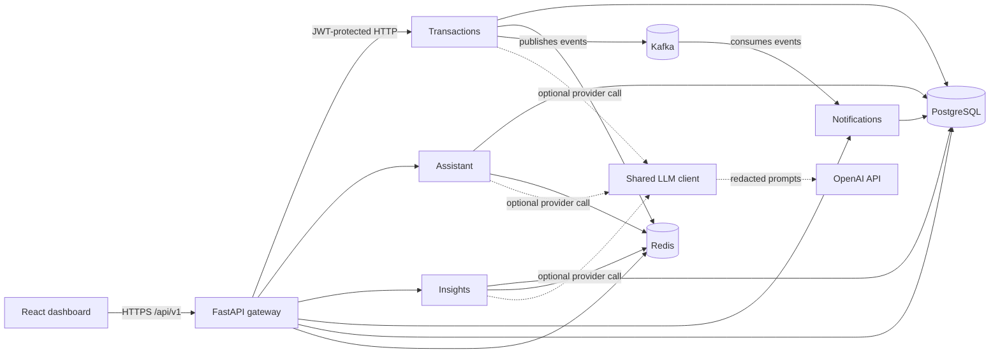

# AI-Powered Financial Application Platform

> AI-enabled microservices, event-driven processing, and cloud delivery for modern financial workflows.

An AI-powered financial application built on Python and FastAPI microservices, integrating LLM APIs, PostgreSQL, Redis, and Kafka to automate financial workflows and deliver scalable, AI-enabled services.

---

## What This Is

A portfolio-grade backend platform that demonstrates how to combine large language models with traditional financial-services infrastructure. It covers the full lifecycle a real fintech backend needs: ingesting transactions, enriching them with AI, reacting to events in real time, and exposing everything through clean, documented APIs.

**Core capabilities:**
- **AI transaction categorization** — LLM-based classification of raw transaction descriptions into spending categories
- **Conversational financial assistant** — natural-language Q&A over a user's own financial data ("How much did I spend on dining last month?")
- **Anomaly flagging** — deterministic scoring of each outflow against the account's own history, with alerts above a threshold
- **AI spending summaries** — on-demand weekly/monthly summaries written from aggregates, plus structured trend data for charts
- **Event-driven alerts** — categorized transactions fan out over Kafka to a Notifications service that raises anomaly, large-transaction and budget alerts
- **Graceful degradation** — every AI path has a deterministic fallback; `LLM_ENABLED=false` runs the whole platform with no provider calls

---

## Tech Stack

| Layer | Technology | Purpose |
|---|---|---|
| API layer | **Python 3.12 + FastAPI** | Async request handling, OpenAPI docs out of the box |
| AI/LLM | **OpenAI API** (`gpt-4o-mini` by default; any OpenAI-compatible endpoint) | Categorization, assistant rewording, summaries |
| Primary datastore | **PostgreSQL** | Accounts, transactions, users, audit trail |
| Cache / session store | **Redis** | LLM response caching, rate limiting, session state |
| Event bus | **Apache Kafka** | Transaction events, notification triggers, async workflows |
| Containerization | **Docker** | Local dev parity, reproducible builds |
| Web client | **React + TypeScript** | Financial overview, transactions, alerts, and assistant |
| Orchestration | **Kubernetes (K8s)** | Local manifests, probes, resource limits, and HPA |
| Cloud target | **AWS** (EKS, RDS, ElastiCache, MSK, ECR) | Terraform and deployment overlay implemented; not provisioned live |
| CI | **GitHub Actions** | Automated backend tests, dashboard build, manifest render, and image builds |

---

## Service Architecture (at a glance)



See [`ARCHITECTURE.md`](./ARCHITECTURE.md) for the full breakdown of services, data flow, and design decisions.

---

## Repository Structure

```
.
├── services/
│   ├── gateway/              # Auth (register/login/refresh/me), JWT, rate limiting, reverse proxy
│   ├── transactions/         # Ingestion, idempotency, categorization, anomaly scoring, events
│   ├── assistant/            # Guardrail → SQL retrieval → draft → LLM rewording
│   ├── insights/             # /summary (aggregates + AI sentence) and /trends (pure SQL)
│   └── notifications/        # Kafka consumer → alert rules → stored alerts + read API
├── libs/
│   ├── common/               # App factory, settings, logging, middleware, auth, redaction
│   ├── db/                   # SQLAlchemy models, repositories, taxonomy, Alembic migrations
│   ├── events/               # Event schemas, Kafka publisher/consumer
│   └── llm_client/           # OpenAI wrapper, cache, rate limiter, breaker, prompts, evals
├── web/                      # React + TypeScript dashboard, served by nginx
├── scripts/                  # seed, eval_categorization, smoke_load, deploy-aws.sh
├── tests/
│   ├── unit/
│   └── integration/          # Full HTTP flows against SQLite with mocked LLM/Kafka
├── infra/
│   ├── docker/Dockerfile     # One backend image; SERVICE selects the app
│   ├── k8s/                  # Kustomize base for a local kind cluster
│   ├── k8s-aws/              # Overlay for EKS with RDS, ElastiCache and MSK
│   └── terraform/aws/        # VPC, EKS, RDS, ElastiCache, MSK, ECR, Secrets Manager
├── docs/                     # Configuration reference and operations runbook
├── .github/workflows/ci.yml
├── docker-compose.yml
├── alembic.ini
├── Makefile
└── pyproject.toml
```

---

## Quick Start (Local Dev)

```bash
# 1. Clone and enter the repo
git clone https://github.com/VamsiKolli10/AI-Powered-Financial-Application-Platform.git
cd AI-Powered-Financial-Application-Platform

# 2. Create the env file if missing. AI is disabled by default.
#    For OpenRouter, Groq's free tier, or OpenAI, follow docs/CONFIGURATION.md.
cp -n .env.example .env

# 3. Start the platform; database-init applies migrations and seeds the demo account
#    before the API services start
docker compose up -d --build

# 4. Confirm initialization succeeded (database-init should show Exited (0))
docker compose ps -a
docker compose logs database-init

# 5. Confirm it's alive and open the dashboard
curl http://localhost:8000/health
# http://localhost:3000
```

### Without Docker

```bash
uv venv --python 3.12 && source .venv/bin/activate
uv pip install -e ".[dev]"

cp .env.example .env    # change postgres/redis/kafka/service hostnames to localhost,
                        # or set KAFKA_ENABLED=false if you have no broker
alembic upgrade head
python -m scripts.seed

# one terminal per service (the Gateway expects 8001-8004 by default)
uvicorn services.gateway.main:app --reload --port 8000
uvicorn services.transactions.main:app --reload --port 8001
uvicorn services.assistant.main:app --reload --port 8002
uvicorn services.insights.main:app --reload --port 8003
uvicorn services.notifications.main:app --reload --port 8004
```

See [`docs/CONFIGURATION.md`](./docs/CONFIGURATION.md) for every setting.

The seed script creates the local starter login `demo@example.com` / `demo-password`
with a Checking account and an empty ledger. Generated sample transactions require an
explicit opt-in: `docker compose exec transactions python -m scripts.seed --demo-transactions`.
To clear samples from an older setup while preserving other transactions and reversing only
the sample balance changes, run `docker compose exec transactions python -m scripts.seed --clear-demo-transactions`.
The local Compose `database-init` job runs migrations and initializes the empty workspace
automatically; it preserves existing credentials and transactions. If initialization fails,
the API services do not start. Inspect `docker compose logs database-init`, fix the cause,
and retry `docker compose up -d --build`.

### Try the API

```bash
TOKEN=$(curl -s localhost:8000/api/v1/auth/login -H 'Content-Type: application/json' \
  -d '{"email":"demo@example.com","password":"demo-password"}' | jq -r .access_token)

curl -s "localhost:8000/api/v1/transactions?limit=5" -H "Authorization: Bearer $TOKEN" | jq
curl -s localhost:8000/api/v1/assistant/chat -H "Authorization: Bearer $TOKEN" \
  -H 'Content-Type: application/json' -d '{"message":"How much did I spend on dining last month?"}' | jq
```

### Common tasks

```bash
make install   # uv venv + dev dependencies + pre-commit hooks
make test      # pytest (SQLite-backed, no Docker needed)
make lint      # ruff + black --check + mypy
make format    # ruff --fix + black
make eval      # categorization accuracy against the labeled sample
make smoke     # load smoke test against a running gateway
make migrate   # alembic upgrade head
make seed      # initialize an empty local workspace; samples require --demo-transactions
make up        # initialize the local database and run docker compose up --build
make logs      # tail the five services
(cd web && npm test)   # dashboard unit and component tests (Vitest)
```

Repeat the full application workflow with real PostgreSQL, Redis and Kafka:

```bash
(cd web && npm ci && npx playwright install chromium)
bash scripts/test_application.sh
```

This creates the disposable `finai-e2e` project on ports 13000 and 18000, tests concurrent
writes, expired claims, API restart, broker outage, duplicate replay and browser actions,
then removes only its own containers and volumes. It does not load your `.env` or call an
AI provider. Do not run two copies simultaneously. CI runs the same sequence. For optional
live AI checks and the held-out quality report, see [evaluation notes](docs/evaluations/README.md).

## How the AI path works

Categorization never blocks the durable write. Ingestion returns `202` immediately, and a
durable PostgreSQL job enriches the row. Workers claim short leases, perform provider calls
outside database locks, and recover expired claims after a restart:

```
cache ──hit──────────────────────────────────────────────▶ category
  │miss
  ▼
rate limiter ──refused──▶ rules engine
  │allowed
  ▼
circuit breaker ──open──▶ rules engine
  │closed
  ▼
OpenAI (retries, timeout, JSON-only) ──error/invalid──▶ rules engine
  │
  ▼
validate against the taxonomy ──▶ cache ──▶ category
```

Every branch on the right produces a categorized transaction, so a provider outage costs
accuracy, never availability. Three details worth calling out:

- **The cache is keyed on the merchant, not the description.** `STARBUCKS #1234 SEATTLE WA` and
  `STARBUCKS #9876 PORTLAND OR` collapse to one key, so a merchant is classified once no matter
  how many branches a user visits. Measured on the demo data, four branch locations of one
  merchant cost a single provider call.
- **The rate limiter lives in Redis**, not in the process, so scaling to N replicas does not
  multiply the effective provider rate limit.
- **Descriptions are redacted before they leave the building.** Card fragments, long digit runs,
  store numbers and reference codes are stripped by `normalize_description`; only the merchant
  string and the amount ever reach the provider.

Watch it work on `/metrics`: `llm_cache_events_total`, `llm_calls_total{outcome=...}` and
`categorizations_total{source=...}`.

## Identity at the edge

Clients talk only to the Gateway, at `/api/v1/*`. It verifies the end-user JWT and then
**mints** the downstream identity rather than forwarding anything the client sent:

```
client ──Authorization: Bearer <jwt>──▶ Gateway
                                          │  verify JWT, rate-limit per user
                                          │  strip any client-supplied identity headers
                                          ▼
                    X-Internal-Token + X-User-Id + X-Request-ID
                                          │
                                          ▼
                        transactions · assistant · insights · notifications
```

Downstream services trust the internal token precisely because only the Gateway can produce
it, and the Gateway itself refuses that token — the only credential accepted at the public
edge is a user JWT. So a client that sends `X-User-Id: someone_else` is served its own data,
and one that presents the internal token gets a 401.

Rate limits are per user and per tier: 100 req/min standard, 20 req/min on LLM-backed routes,
in a Redis bucket shared across replicas. If Redis is unreachable the limiter degrades to a
per-replica bucket rather than failing open — a cache outage should cost the *accuracy* of the
limit, not the limit itself.

## How the assistant stays honest

Ask *"How much did I spend on dining last month?"* and the answer is built like this:

1. **Guardrail first.** Write intent is refused before any retrieval or model call — a gate in
   code, not an instruction in a prompt. `Move $50 to savings` gets `400 READ_ONLY_ASSISTANT`;
   `How much did I transfer to savings last month?` is answered, because it is a question about
   history.
2. **Retrieve.** The question is parsed into a period and category, and the figures come from a
   SQL aggregate scoped to the asking user's own accounts. No vector database: the questions are
   about a structured ledger, so the right retrieval is a scoped aggregate, not a similarity search.
3. **Draft in Python.** A correct sentence is composed from those figures. All arithmetic happens
   here.
4. **Reword with the model.** The model receives the facts and the draft, and is told to improve
   the wording and invent nothing. If it fails, is rate limited, or returns junk, the draft is
   what the user sees.

Replies and summaries must retain the draft's ordered figures, currency markers, category and
merchant anchors, and comparison direction. Invalid provider or cached output uses the computed
draft. This conservative check can reject valid paraphrases; it checks numerical grounding, not
semantic equivalence of arbitrary prose. The response carries `reply_source` (`llm` or `draft`).

## What one transaction sets off

```
POST /transactions ──▶ row written (pending_categorization) ──▶ 202 Accepted
                                    │
                         durable job (leased claim)
                                    ▼
                        category + anomaly score
                                    │
                     same commit: category + outbox events
                                    │
                   acknowledged Kafka publish + retry on failure
                          ├── transaction.categorized
                          └── transaction.anomaly_flagged   (score ≥ threshold)
                                    │
              ┌─────────────────────┴─────────────────────┐
              ▼                                           ▼
      Notifications consumer                      Insights (/summary)
      alert rules → stored alert                  aggregates from Postgres,
      → GET /notifications                        AI sentence on top
```

Events are stored atomically with enrichment and job completion, then published after commit.
A broker outage leaves events pending. Claims serialize an account's outbox while allowing
other accounts to advance. An expired lease is recoverable and fences stale database writes.
Retries retain the same event ID. A crash after acknowledgement can replay an event, so delivery
is at least once. Consumers are idempotent (alerts carry a dedupe key) because Kafka delivers at
least once. A failed handler or offset commit retries the same record before the consumer
advances, so a later commit cannot skip a failed event. Malformed events are logged and skipped
without stopping the loop.
Rebalance callbacks resume polling after revocation so a long retry does not prevent rejoining.
Notification delivery stays pending until channel success; event replay retries that work after
a failure or restart. Run `alembic upgrade head` for the delivery-tracking schema before starting
the updated Notifications service.

Set `LLM_ENABLED=false` (or leave `OPENAI_API_KEY` empty) and the whole platform runs on the
deterministic rules engine — that mode is a first-class citizen, not a broken state.

Interactive API docs (Swagger UI) are served by every service at `/docs`. The Gateway's
(`:8000/docs`) covers the auth routes; open `:8001`–`:8004/docs` for each service's full
models. The written reference is [`API_DESIGN.md`](./API_DESIGN.md).

## React dashboard

The dashboard at `http://localhost:3000` is a real client of the Gateway, not a static mockup.
After signing in with the seeded demo user, it shows money in, money out and cash flow for the
selected month or week, the spending summary and category breakdown, recent transactions with
their categorization source, and alerts, and sends grounded questions to the read-only assistant.
Select an owned account to enter transactions or import a CSV, correct categories, and mark
alerts as read. Writes refresh the dashboard while asynchronous enrichment catches up.
If one service is down, only its section shows as unavailable. nginx keeps browser traffic
same-origin and proxies `/api/*` to the Gateway. Components, tokens and accessibility notes are in
[`docs/DESIGN_SYSTEM.md`](./docs/DESIGN_SYSTEM.md).

For frontend-only development:

```bash
cd web
npm ci
npm run dev
```

---

## Implementation Highlights

- Developed Python and FastAPI microservices that integrate LLM APIs with PostgreSQL, Redis, and Kafka to automate financial workflows end to end.
- Implemented backend API integration, event-driven processing, and caching to keep AI-enabled services responsive under load.
- Covered delivery with automated testing, containerization, Kubernetes manifests, and validated AWS infrastructure definitions.

---

## Documentation

| Doc | Purpose |
|---|---|
| [`ARCHITECTURE.md`](./ARCHITECTURE.md) | System design, service boundaries, data model, data flow, key decisions |
| [`API_DESIGN.md`](./API_DESIGN.md) | Endpoint reference: auth, errors, rate limits, request/response contracts, Kafka events |
| [`docs/CONFIGURATION.md`](./docs/CONFIGURATION.md) | Every environment variable, LLM modes, per-environment config sources |
| [`docs/OPERATIONS.md`](./docs/OPERATIONS.md) | Health checks, metrics, logs, degraded modes, troubleshooting, known issues |
| [`BUILD_PLAN.md`](./BUILD_PLAN.md) | Phased roadmap and what each phase delivered |
| [`docs/DESIGN_SYSTEM.md`](./docs/DESIGN_SYSTEM.md) | Dashboard tokens, components, accessibility audit and priorities |
| [`infra/k8s/README.md`](./infra/k8s/README.md) | Running the full platform in a local `kind` cluster |
| [`infra/terraform/aws/README.md`](./infra/terraform/aws/README.md) | AWS architecture, cost boundary, plan/apply, deployment and rollback |
| [`CONTRIBUTING.md`](./CONTRIBUTING.md) · [`SECURITY.md`](./SECURITY.md) | Development workflow and vulnerability reporting |

---

## Status

🚧 Portfolio project — actively being built.

| Phase | State |
|---|---|
| 0 — Project setup, Docker Compose, CI | ✅ Complete |
| 1 — Core data layer (models, migrations, seed) | ✅ Complete |
| 2 — Transactions service (ingest, idempotency, rules categorizer) | ✅ Complete |
| 3 — LLM integration (caching, rate limiting, circuit breaker) | ✅ Complete |
| 4 — Kafka event bus, Notifications + Insights | ✅ Complete |
| 5 — Assistant service (conversational Q&A) | ✅ Complete |
| 6 — Gateway, auth, rate limiting, observability | ✅ Complete |
| 7 — Kubernetes manifests and local `kind` deploy | ✅ Complete |
| 8 — CI/CD and cloud deployment | 🟡 CI and AWS Terraform implemented; live AWS deployment not yet executed |
| 9 — Portfolio polish | 🟡 React dashboard implemented; media/live demo planned |

## License

Licensed under the [MIT License](LICENSE).

## Contributing and security

See [CONTRIBUTING.md](CONTRIBUTING.md) for setup and checks, and
[SECURITY.md](SECURITY.md) for private vulnerability reporting.
